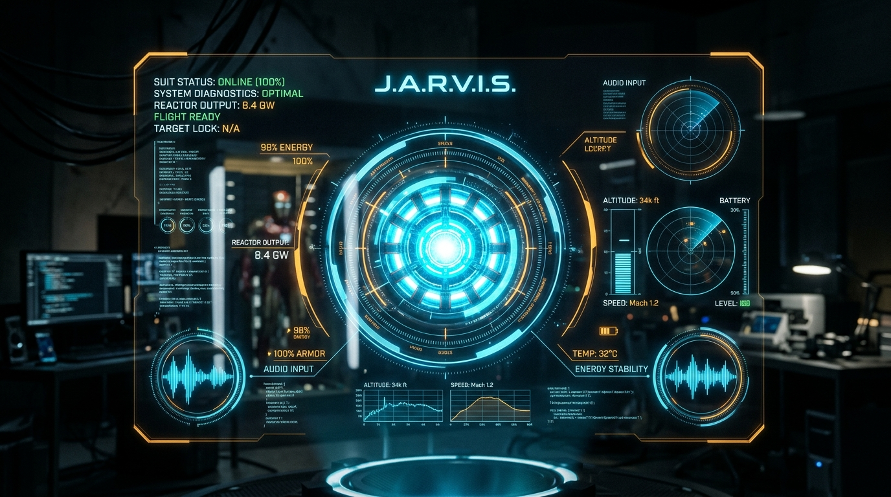

# J.A.R.V.I.S. — Iron Man Holographic AI Assistant

<p align="center">
  
</p>

<p align="center">
  <a href="https://jarvis-ironman-bay.vercel.app/"></a>
  
  
</p>

### 🌐 Live Web Demo
Experience the interactive holographic interface directly in your browser:  
👉 **[https://jarvis-ironman-bay.vercel.app/](https://jarvis-ironman-bay.vercel.app/)**

---

## ⚡ Overview

A browser-based voice assistant built with an authentic **Iron Man holographic HUD interface**. Say **"Hey Jarvis"**, and he wakes, listens, and performs real-world actions across connected tools — searching the web, generating images, controlling browsers, and processing live computer vision telemetry.

- **The Holographic Face**: React + Vite + Three.js + custom GLSL shaders rendering an interactive Arc Reactor, telemetry blades, and MediaPipe hand tracking.
- **The Brain**: Claude Agent SDK running headless locally with full MCP tool support.
- **Voice Stack**: Local Voice Activity Detection (VAD) + Picovoice wake word engine + browser speech & ElevenLabs integration.

**The only subscription you need is Claude Code.** No API keys, no OpenAI account, no cloud bill — the brain runs on your existing Claude Code login, and the heavy work runs on Anthropic's servers, so even a lightweight laptop only has to draw the interface. **ElevenLabs is an optional add-on** that gives JARVIS a much better voice and sharper hearing; without it he speaks and listens through the browser's own speech, and everything still works.

---

## Requirements

**In one line:** a Claude Code subscription, plus two free things every computer
can have — Node.js and Chrome. That's the whole list.

- **Claude Code, installed and logged in** — this is the only account you need.
  Install it with the official method — `npm install -g @anthropic-ai/claude-code`,
  or the platform installer at <https://docs.claude.com/en/docs/claude-code> —
  then run `claude` once and complete login. The bridge reuses that login. **No
  API key**, and usage is billed to your existing Claude account.
- **Node.js 20 or newer** — free, one installer from <https://nodejs.org>. This
  is a Node web app, so it is the one unavoidable tool.
- **Google Chrome or Microsoft Edge**, in a **real browser window** — not an
  embedded preview pane. Preview panes (including the one inside editors and
  Claude Code) block microphone access, so the page loads and looks right but
  never hears you. JARVIS also needs WebGL, which these browsers provide.
- **Optional: an ElevenLabs API key** — a good add-on, not a requirement. It
  gives a better voice and sharper transcription; the free tier is plenty for a
  demo. Without it, everything runs on the browser's own speech.

Run `npm run setup` after cloning and it checks all of this for you, in plain
language.

---

## 🚀 Autonomous macOS Voice Assistant (`python3 main.py`)

J.A.R.V.I.S. now includes a general-purpose, native macOS voice assistant powered by Claude LLM tool-calling and natural language understanding across **English, Hindi, and Hinglish**.

### Features
- 🎙️ **Natural Voice Input**: Real-time microphone capture with ambient noise calibration and automatic silence endpointing.
- 🧠 **Claude LLM Tool Calling**: General system that understands any conversational request and decides which tools to invoke.
- 💻 **Native App Control**: Opens any app (`WhatsApp`, `Instagram`, `Chrome`, `Spotify`, etc.) using `open -a` with fuzzy-matching and web fallback.
- 📁 **Spotlight File Search**: *"open my resume"* finds and opens documents instantly using macOS Spotlight (`mdfind`).
- 🔊 **System Telemetry**: Adjust volume (e.g. *"turn volume to 30"*), mute/unmute, screenshot, sleep, and lock screen.
- 🛡️ **Safety Gating**: Destructive actions (file deletion, sudo, messages) always require verbal confirmation.
- 📝 **Live Logging**: All turns, commands, and results are logged to `jarvis.log`.

### Setup & Run
```bash
# 1. Install Python requirements
pip install -r requirements.txt

# 2. Configure your API key
cp .env.example .env
# Edit .env and paste your ANTHROPIC_API_KEY (optional: also works with offline fallback)

# 3. Launch J.A.R.V.I.S.
python3 main.py
```

### macOS Permissions Required
Enable in **System Settings > Privacy & Security**:
- **Camera**: Allow Terminal / VS Code / Python (for Hand Gesture tracking)
- **Accessibility**: Allow Terminal / VS Code / Python (for Mouse Control & Keystrokes)
- **Microphone**: Allow Terminal / VS Code (for Voice Input)
- **Automation**: Allow System Events
- **Screen Recording**: Allow Terminal / IDE (if taking screenshots)

---

## ✋ High-Precision Hand Gesture Control

J.A.R.V.I.S. includes a rebuilt, zero-lag Python MediaPipe hand gesture engine running in a separate thread.

### Quick Start
```bash
# Run gesture detector directly with live OpenCV debug HUD:
python3 gesture_detector.py

# Or run comprehensive unit tests & rotation tolerance suite:
python3 test_gestures.py
```

### Voice Commands to Control Gestures
Say to Jarvis:
- *"Jarvis, start gesture control"* (or *"start gesture control with camera"*)
- *"Jarvis, stop gesture control"*
- *"Jarvis, toggle gesture debug"*

### Supported Gestures (`gestures.json`)
| Gesture | Landmark Logic | Action | Spoken Confirmation |
| :--- | :--- | :--- | :--- |
| **Wake Palm** | Open palm held steadily for 1.0s | Wakes & enables gesture control | *"Jarvis gesture control online, Sir."* |
| **Open Palm** | 5 fingers extended | Pause / stop listening | *"Listening paused, Sir."* |
| **Fist** | All fingers curled into ball | Mute audio / stop media | *"Muting audio, Sir."* |
| **Index Up** | Index extended, others curled | Move mouse pointer smoothly | Cursor tracked via active box |
| **Pinch** | Thumb & Index tip touching | Mouse click (`pyautogui.click()`) | Click executed |
| **Peace Sign** | Index & Middle extended | Scroll down | Page scrolled down |
| **Thumbs Up** | Thumb up, 4 fingers curled | Confirm / "Yes" | *"Confirmed, Sir."* |
| **Thumbs Down**| Thumb down, 4 fingers curled | Cancel / "No" | *"Cancelled, Sir."* |
| **Swipe Left** | Rapid wrist displacement left | Previous track / back | *"Previous, Sir."* |
| **Swipe Right**| Rapid wrist displacement right | Next track / forward | *"Next, Sir."* |

### Anti-False-Trigger & Stability Features
1. **Exponential Moving Average (EMA)**: $\alpha = 0.5$ on all 21 landmarks eliminates sensor jitter without adding perceptible lag.
2. **Rotation-Tolerant Math**: Calculates Euclidean distance from Wrist (landmark 0) instead of raw y-coordinates, keeping gestures reliable when your hand tilts up to 60°.
3. **Handedness-Aware Thumb**: Checks lateral motion relative to MCP joints and palm vector in a mirrored frame.
4. **8-Frame Debounce & 1.0s Cooldown**: Discrete gestures must hold for 8 consecutive frames before firing, with a 1-second cooldown preventing double triggers.
5. **Mouse Active Box**: Index fingertip within a central 20%–80% sub-rectangle maps to the full macOS desktop, eliminating arm fatigue.
6. **Debug HUD**: Press **`d`** anytime in the OpenCV window to toggle the visualizer.

### Calibration & Best Practice Tips
- **Lighting**: Ensure even, frontal or overhead lighting. Avoid strong backlights (e.g., sitting directly in front of a bright window).
- **Distance**: Sit 1.5 to 3 feet (0.5m – 1m) from your webcam so your hand occupies roughly 15%–35% of the frame.
- **Background**: Avoid complex backgrounds with skin-toned clutter or moving fans.
- **Hand Orientation**: Keep your palm facing toward the webcam for maximum landmark confidence.

---

## 🌐 Web Interface Quick Start

First, install, then start it:

```bash
npm install
npm start          # runs the brain and the face together
```

Then open the URL it prints (http://localhost:5173) in **Chrome**, click **INITIALISE**, and say **“Hey Jarvis”**.

Prefer two terminals? Run them separately instead:

```bash
npm install
```

Terminal 1 — the brain:

```bash
npm run bridge
```

Terminal 2 — the face:

```bash
npm run dev
```

Then open the app in a **real Chrome or Edge window**:

```bash
open http://localhost:5173
```

Click **INITIALISE**, allow the microphone when asked, and say **"Hey Jarvis"**.

> It has to be a real browser window. Embedded preview panes block the
> microphone, so JARVIS will look perfectly alive and simply never respond.

---

## How it works

JARVIS is two processes. The browser is the face and the voice; the bridge is
the brain and the hands.

```
  ┌─ browser (the face) ───────────────┐        ┌─ bridge (the brain) ─────────────┐
  │  "Hey Jarvis" wake word            │        │  Node · bridge/server.mjs        │
  │  local VAD  →  speech to text      │   ws   │  Claude Agent SDK                │
  │  reactor UI (Three.js + GLSL)      │◄─────► │   = Claude Code, headless        │
  │  text to speech                    │  8787  │  spawns your MCP servers         │
  │  heads-up display                  │        │  permission gate (decideTool)    │
  └────────────────────────────────────┘        └──────────────────────────────────┘
```

Everything you see and hear happens in the browser. The bridge is a single Node
process (`bridge/server.mjs`) that runs the **Claude Agent SDK**
(`@anthropic-ai/claude-agent-sdk`) — this spawns the real `claude` CLI as a child
process, so **the brain literally is Claude Code, headless.** They talk over a
WebSocket (plus a few HTTP endpoints) on `ws://localhost:8787`.

**Why a bridge at all?** A browser tab cannot spawn the local stdio MCP servers —
`higgsfield`, `elevenlabs`, `android`, `playwright`, `exa`, `serper`, and the
rest. The bridge can. And because it is the Agent SDK, it authenticates off your
existing Claude Code login: no API key, billed to that same Claude account.

**The model.** `claude-opus-5` at effort `medium` by default. Override with the
`JARVIS_MODEL` and `JARVIS_EFFORT` environment variables. On startup the bridge
prints its choice, e.g. `[jarvis] model claude-opus-5 · effort medium`.

### The voice pipeline

The loop is designed so that nothing silently dies and barge-in feels natural.

- **Detection is local.** An energy-based voice-activity detector
  (`src/lib/vad.ts`) decides when you are speaking. It is instant, cannot quietly
  fail, and is what makes **barge-in** work — speak while JARVIS is talking and he
  stops.
- **Transcription has two tiers, chosen automatically at boot.** The browser asks
  the bridge `/health` and picks the best available:
  - **ElevenLabs key present** → ElevenLabs Scribe, via the bridge `/stt` endpoint.
  - **Nothing configured** → the browser's own `SpeechRecognition` (Chrome/Edge),
    guarded by a heartbeat so it recovers when Chrome throttles it.
- **Speaking** uses the **ElevenLabs voice when a key is present**, and the
  browser's `speechSynthesis` otherwise. If a cloud call fails it falls back to
  the browser voice, and if the OS voice itself is broken it latches over to the
  cloud voice.

So it works with no keys and auto-upgrades when a key appears — there is no flag
to set. Capability detection lives in `src/lib/capabilities.ts`, which probes the
bridge's `GET /health` (returning `{ ok, tts, stt }`, both tracking the
ElevenLabs key) once at boot and picks the engines.

---

## What JARVIS can do

Beyond answering, JARVIS reaches every MCP server in your Claude Code
configuration, and can drive his own interface.

### Your tools

Every server in your `~/.claude.json` is handed to the SDK explicitly. Depending
on what you have installed, that is roughly:

- **Web & search** — `exa`, `serper`, `serpapi`
- **Images & video** — `higgsfield`, `openrouter-image`, `palmier-pro`
- **Voice** — `elevenlabs`
- **Your phone** — `android`
- **The browser** — `playwright`

A few things you can say:

- *"What's happening in AI this week?"*
- *"Generate an image of the Mark VII suit."*
- *"Take a screenshot of my phone."*
- *"Open my GitHub notifications."*

> **Note on account connectors.** Servers you added through your **claude.ai
> account** are not stored on disk, so the bridge cannot see them — it works from
> the servers in `~/.claude.json` (about 14), not the claude.ai ones.

### JARVIS controls the interface

He drives the UI through MCP tools the bridge exposes:

- `ui_theme` — accent, background, per-phase colours
- `ui_reactor` — colour, scale, intensity, spin, and style (`ring` | `sphere` | `wire`), visibility
- `ui_orbit` — put images in orbit around the reactor
- `ui_chrome` — show or hide rails, transcript, badges
- `ui_effect` — `glitch` | `pulse` | `scan` | `shake` | `flash`
- `ui_screen` — clear
- `ui_reset` — back to defaults

So *"make it red, hide the systems list, put that render in orbit"* is a spoken
command.

### The heads-up display

JARVIS authors panels with a `display` tool against a fixed `.hud-*` design
system. The browser sanitises the markup (DOMPurify, a class allowlist and a
strict CSP) before rendering. Rich media works — images, `<video>`, and
YouTube/Vimeo embeds. Remote images and video are fetched **server-side** through
the bridge (`/img` and `/media`, both SSRF-guarded), so hotlink-blocked news
thumbnails still appear and the page never beacons your IP to a host the model
chose.

---

## Controls

| Key / phrase | Does |
|---|---|
| **"Hey Jarvis"** | Wake him |
| **Space** | Talk without the wake word |
| Just speak | Interrupt him mid-sentence (barge-in) |
| **V** | Cycle the browser voice |
| **Escape** | Stand down |
| **D** | Live diagnostics panel |
| **T** | One-line audio self-test |

---

## The boot sequence

Power-up plays a four-beat Iron Man start-up (`src/ui/Boot.tsx`): an
"INITIATING SYSTEM" status bar with a segmented progress bar and boot log; then
concentric reticle rings resolving into "J.A.R.V.I.S"; then a suit schematic;
then the triangular arc reactor lighting up — with a start-up sound under it
(`public/audio/boot-music.mp3`).

---

## Configuration

Everything is optional in bridge mode. Frontend settings live in `.env.local`
(copy `.env.example`); bridge settings are environment variables.

### Bridge

| Variable | Default | Effect |
|---|---|---|
| `JARVIS_BRIDGE_PORT` | `8787` | Port for the WebSocket + HTTP endpoints |
| `JARVIS_MODEL` | `claude-opus-5` | Model to run |
| `JARVIS_EFFORT` | `medium` | Reasoning effort |
| `JARVIS_ALLOW_WRITES` | off | `1` allows effectful tools (see below) |
| `JARVIS_ALLOWED_ORIGINS` | local dev | Extra WebSocket origins to accept |
| `JARVIS_ALLOW_NO_ORIGIN` | off | Accept connections with no `Origin` header |
| `JARVIS_FILE_ROOTS` | — | Roots the `/file` endpoint may serve from |
| `JARVIS_VOICE_ID` | — | ElevenLabs voice id |
| `ELEVENLABS_API_KEY` | — | Optional; enables the ElevenLabs voice + Scribe |

### Frontend (`.env.local`)

| Variable | Effect |
|---|---|
| `VITE_BACKEND` | `bridge` (default) or `direct` |
| `VITE_BRIDGE_URL` | Where to reach the bridge |
| `VITE_TTS_ENGINE` | `system` or `kokoro` |
| `VITE_KOKORO_VOICE` | Voice for the Kokoro engine |
| `VITE_USE_ELEVENLABS` | Force the ElevenLabs voice on |
| `VITE_ANTHROPIC_API_KEY` | Direct mode only |

### Adding an ElevenLabs key

You do not have to touch a flag. Either:

- Set `ELEVENLABS_API_KEY` on the bridge before starting it, **or**
- Add the key to your `elevenlabs` MCP server's env in `~/.claude.json` — the
  bridge reads it from there too.

Either way, `/health` starts reporting the capability, the browser picks it up on
the next boot, and both the voice and transcription upgrade automatically.

---

## Enabling actions

The tool gate starts **read-only**. Search, generation and lookups run freely;
anything effectful — send, tap, delete, install, pay — is denied. Voice is a poor
interface for a confirmation dialog, so the decision is made ahead of time in
`decideTool()` in `bridge/server.mjs`, not at the moment of use. The bridge sets
`settingSources: []`, which makes its own gate the only authority — filesystem
settings and any global `bypassPermissions` cannot override it.

To allow effectful tools (phone, browser driving, sending), run the bridge this
way instead:

```bash
npm run bridge:writes
```

> Read `decideTool()` before you do. *"Hey Jarvis, clean up my downloads folder"*
> means something rather different with writes enabled.

---

## Troubleshooting

**I can't hear him, or he can't hear me.** Press **D** for the diagnostics panel
— it states plainly whether he is hearing you and whether he is producing sound.
Press **T** for a one-line audio self-test.

**No voice at all.** You must be in **Chrome or Edge**, in a **real browser
window** (not an embedded preview), and you must have **allowed the microphone**.

**Bridge not reachable.** Check that `npm run bridge` is still running in its
terminal, and that nothing else is holding port `8787`.

---

## Security

All of this lives in `bridge/server.mjs`:

- The WebSocket accepts only local dev origins (add more with
  `JARVIS_ALLOWED_ORIGINS`).
- `/file`, `/img` and `/media` validate the scheme, confine to allowed roots,
  resolve the real path, and refuse private and loopback addresses (SSRF guard).
- The tool gate (`decideTool`) is default-deny for effectful MCP tools.
- A strict CSP in `index.html`; model-authored panel HTML is sanitised.

---

## Credits & licence

MIT.

The boot sound and any tracks in `public/audio/` ship with the project for the
demo. If you go on to monetise something built on this, clearing the rights to
that audio is your responsibility.
